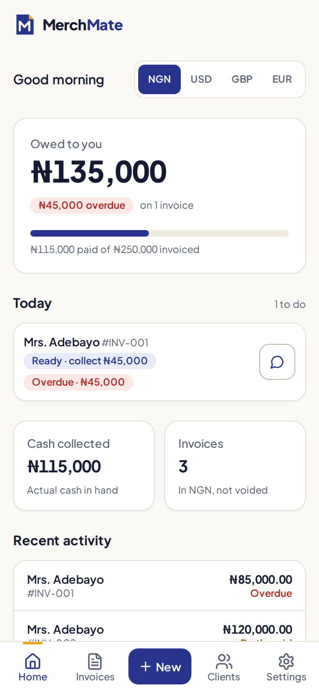
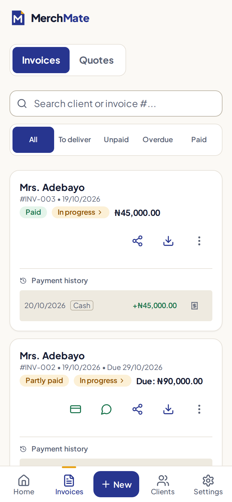

# MerchMate: Smart Invoicing

An offline-first invoicing app for small businesses. Create invoices, quotes and receipts, track payments and orders, and chase unpaid balances on WhatsApp, all from your phone and without an internet connection. It was first built for Nigerian Aso Oke textile sellers and works for any business that sells goods or services.

**Live app: <https://invoice-aso-oke.vercel.app/>**

| Home | Invoices |
|---|---|
|  |  |

*Screenshots use demo data.*

## Contents

- [Features](#features)
- [How your data is stored](#how-your-data-is-stored)
- [Install it on your phone](#install-it-on-your-phone)
- [Getting started (development)](#getting-started-development)
- [Scripts](#scripts)
- [Project structure](#project-structure)
- [How it works](#how-it-works)
- [Deployment](#deployment)
- [Troubleshooting](#troubleshooting)
- [Roadmap](#roadmap)
- [Audits](#audits)
- [Privacy, terms and support](#privacy-terms-and-support)
- [Contributing](#contributing)
- [License](#license)

## Features

**Invoicing**
- Invoices and quotes with line items (decimal quantities and prices), percentage or fixed discounts, tax/VAT with per-business defaults, notes and due dates.
- Smart numbering that continues from your most recent number and keeps its format (`2026/INV/07` becomes `2026/INV/08`). Quotes are numbered separately (`QUO-001`).
- Convert an accepted quote into an invoice in one tap, or duplicate any document.
- Saved items: the items and prices you bill are remembered and suggested as you type.
- Four currencies: NGN (₦), USD ($), GBP (£), EUR (€). Amounts in different currencies are never added together.
- Invoice PDFs with your logo and brand colour, in a classic or modern template.

**Getting paid**
- Partial payments and deposits, with a status that follows the money: pending, partial, paid, and overdue (worked out from the due date, never stored).
- A receipt PDF for every payment, numbered `INV-004-R2`, showing the totals as of that payment.
- **Fake-alert protection:** a bank transfer you have not yet seen in your account is recorded as *unconfirmed*. It does not reduce the balance, appear on receipts or count in reports until you confirm it.
- Optional **payment plans**: split an invoice into instalments (for example 50% now, 30% at fitting, 20% on collection) with dates. Reminders ask only for what is due.
- WhatsApp payment reminders with the balance and your bank details, and statements per client.
- **Void, not delete:** an invoice that has payments is never deleted, because receipts were issued against it. Void it instead; it stays on record but no longer counts as owed. Reinstate it any time.

**Orders and follow-up**
- Order stages (in progress, ready, delivered) with a delivery date. When an order is ready, the WhatsApp button sends a "your order is ready" message instead of a payment reminder.
- A **Today** list on the dashboard of everything that needs you: unconfirmed transfers, ready orders, overdue balances, and late or due deliveries.

**Sharing**
- Send an invoice as a PDF, as an image that opens right in the chat, or as WhatsApp text, using your phone's share sheet.

**Money insight**
- Dashboard with cash collected, pending, overdue and unconfirmed amounts per currency.
- Monthly cash collected (by payment date), top clients, and CSV export of invoices and payments for Excel or your accountant.
- **Private job costs and profit:** record materials, labour and transport on a job to see its profit. Costs never appear on anything the client sees.

**Your data and safety**
- Everything works offline and is stored on your device.
- **App Lock** (optional): protect the app with a PIN. If you forget it, a recovery code gets you back in; if you lose both, you can erase the device and restore a backup. It keeps casual snoopers out; it is not encryption.
- Backup and restore to a file (save it to Google Drive, email or WhatsApp), with a daily reminder ("Back up now" or "Not today") until you have saved one that day, and a prompt to back up right after you turn on App Lock.
- A data-protection status screen, and an install prompt for iPhone/iPad where Safari can erase data of websites that are not installed.
- An opt-in "Report a problem" that creates a text file (no client or money details) you can send for support.
- Update prompt: new versions wait until you tap *Update*, so a half-written invoice is never lost.
- Choose how dates are shown (day first, month first, long or ISO), identical on every device.

## How your data is stored

MerchMate has **no backend**. Your business profile, clients, invoices, payments and saved items live in your browser's IndexedDB on the device you use. That makes it fast, private and fully offline, with one consequence you should know about:

> Clearing browser data, uninstalling the app or losing the phone deletes your records. **Save a backup regularly** (Settings → Backup & Restore). You can also use a backup to move to a new phone.

The app never sends your records anywhere. Details are in the [Privacy Policy](public/privacy.html).

## Install it on your phone

Open <https://invoice-aso-oke.vercel.app/> in your phone's browser.

- **Android (Chrome):** menu (three dots) → *Install app* or *Add to Home Screen*.
- **iPhone / iPad (Safari):** Share button → *Add to Home Screen*. This matters: Safari can clear the data of websites that are not installed after about a week without a visit.

Launch it from your home screen. After the first load it works with no connection (try Airplane Mode).

## Getting started (development)

**Requirements:** Node.js 20 or newer and npm.

```bash
git clone git@github.com:asejik/merchmate.git
cd merchmate
npm install
npm run dev
```

The dev server runs at <http://localhost:5173>. The PWA service worker is disabled in dev to avoid caching surprises; use `npm run build && npm run preview` to test installing and offline behaviour.

There are no environment variables to set: the app has no backend. (`.env.example` lists the Supabase variables reserved for the planned sync feature; nothing reads them yet.)

> **WSL users:** if `npm` resolves to a Windows install under `/mnt/c/...` it fails on WSL paths. Put the Node installed in WSL (for example via nvm) first in your `PATH`.

## Scripts

| Command | What it does |
|---|---|
| `npm run dev` | Vite dev server with hot reload |
| `npm run build` | Production build to `dist/` (does **not** type-check) |
| `npm run typecheck` | `tsc -b` in strict mode (unused locals and parameters are errors) |
| `npm run lint` | ESLint (flat config) |
| `npm test` | Vitest, single run |
| `npm run test:watch` | Vitest in watch mode |
| `npm run preview` | Serve the production build, including the service worker |

Run a single file or test: `npx vitest run src/lib/invoice.test.ts -t "applyPayment"`.

Before pushing a change, run `npm run typecheck && npm run lint && npm test && npm run build`.

## Project structure

```
public/                 Static files: icons, privacy.html, terms.html
vercel.json             Vercel build settings
docs/
  audits/               Audit reports (production readiness, and others as they are run)
  screenshots/          Images used in this README
src/
  components/
    customers/          Client list and form, statement PDF
    dashboard/          Dashboard, Today list, reports
    forms/              Settings: business profile, backup, data protection, problem report, help
    invoices/           Invoice form and list, payment modal, invoice and receipt PDFs
    layout/             App shell and navigation
    ui/                 Shared pieces: glass card, share modal, update banner, error screens
  db/
    index.ts            Dexie database and schema versions
    mutations.ts        Transactional writes: payments, saving, voiding, deleting
    backup.ts           Export and restore against the database
  lib/                  Pure logic with tests (money, dates, reports, WhatsApp text, CSV, ...)
  types/                Shared TypeScript types
```

## How it works

**Stack:** React 18, Vite, TypeScript (strict), Tailwind CSS v4, Dexie (IndexedDB), Framer Motion, React Hook Form with Zod, `@react-pdf/renderer`, and `vite-plugin-pwa` (Workbox).

- **No router.** `App.tsx` keeps the active tab in state (saved in `localStorage`) and switches between Home, Invoices, New, Clients and Settings.
- **Data layer.** The Dexie database is named `AsoOkeInvoiceDB` for historical reasons. **Never rename it**: that would orphan every existing user's data. Tables are `businessProfile`, `customers`, `invoices` (which also holds quotes) and `catalog`. Schema changes always go in a *new* `version(n)` block; existing ones are never edited. Anything that reads and then writes goes through `src/db/mutations.ts`, which re-reads inside a transaction so a second tab or window can never be overwritten by a stale copy.
- **Money logic lives in `src/lib/invoice.ts`** (totals, discounts, tax, status, balances, payments, payment plans, receipts) and is covered by tests. Components must not re-implement it. Amounts are rounded to 2 decimals at every step.
- **Dates.** Calendar dates (issued, due, delivery) are stored as UTC midnight and displayed through `formatDate`; real moments (payments) are timestamps. Never use `toLocaleDateString`, because device locales differ.
- **PDFs** are rendered by a lazily loaded chunk (about 1.3 MB) so the main bundle stays small; the service worker precaches it so PDFs work offline. Sharing uses the Web Share API (WhatsApp on mobile) and falls back to a download.
- **Backups** are versioned, validated JSON that restores in a single transaction: on any error nothing changes.
- **Tests** cover the pure logic in `src/lib` and the database layer in `src/db` (using `fake-indexeddb`).

More detail for contributors, including conventions and gotchas, is in [`CLAUDE.md`](CLAUDE.md).

## Deployment

The app is a static site hosted on [Vercel](https://vercel.com).

- **Live URL:** <https://invoice-aso-oke.vercel.app/>
- **Releases:** pushing to `main` deploys automatically.
- **Build settings:** recorded in [`vercel.json`](vercel.json) (framework Vite, build command `npm run build`, output directory `dist`), so they do not depend on the dashboard. No environment variables are needed.
- **Roll back a bad release:** in the Vercel dashboard open *Deployments*, pick the last good one, and choose *Promote to Production* (or revert the commit and push). People using the installed app receive the older version through the normal *Update* prompt.
- **Schema caution:** a release that raises the Dexie schema version cannot be undone by rolling back, because older code cannot open a newer database. The app shows a clear "Can't open your data" screen in that case, but treat schema bumps as one-way.
- **Custom domain:** add it in Vercel under *Settings → Domains* and follow the DNS instructions. HTTPS certificates are issued automatically.

## Troubleshooting

**PDF generation fails or "Buffer is not defined".** The PDF engine needs Node polyfills in the browser. `vite.config.ts` configures `vite-plugin-node-polyfills` and `define: { global: 'window' }`, and `main.tsx` assigns `window.Buffer`. Do not remove them.

**`__SECRET_INTERNALS...` error, or the app fails after an install.** `@react-pdf/renderer` does not work with React 19. This project pins React to 18.3.1 through `overrides` in `package.json`. If React 19 gets installed, reset and reinstall:

```bash
rm -rf node_modules package-lock.json
npm install
```

**`typescript-eslint` will not install.** It is pinned to `~8.70` because the 8.71.0 tarballs were missing from npm.

**The installed app shows old content.** New versions wait for you: tap *Update* when the banner appears, or close and reopen the app.

**"Can't open your data".** The browser could not open its storage. This happens in private/incognito windows, when the phone is almost out of space, or when an older tab of the app is still open. Close other MerchMate tabs, leave private mode, free some space and try again.

## Roadmap

Phase 1 (this app) is complete. Phase 2 is deliberately deferred and is not started:

- Cloud sync across devices (Supabase)
- Online payments (Paystack)
- Shareable online invoice links

## Audits

Audit reports are kept in [`docs/audits/`](docs/audits/). The first is the [production readiness audit](docs/audits/P03_2026-10-16.md).

## Privacy, terms and support

- [Privacy Policy](public/privacy.html) and [Terms of Use](public/terms.html) (served by the app at `/privacy.html` and `/terms.html`)
- Support: <info@asejik.com>. In the app, *Settings → Report a Problem* creates a diagnostics file you can attach.

## Contributing

1. Fork the repository and create a branch (`git checkout -b feature/short-description`).
2. Make your change, following the conventions in [`CLAUDE.md`](CLAUDE.md), and add tests for any logic in `src/lib` or `src/db`.
3. Run `npm run typecheck && npm run lint && npm test && npm run build`.
4. Commit with a message that says what changed and why, push, and open a pull request.

## License

Copyright (c) 2026 asejik. All rights reserved. The code is proprietary: see [`LICENSE`](LICENSE). Contact <info@asejik.com> to ask for permission to use it.
